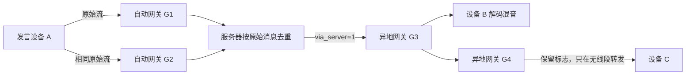

# YuanbaoTalk 共同协议规格

版本：v0.2 评审草案，2026-10-03。文档修订号与无线头 version 独立，当前无线格式仍为 1。本文定义固件、无线中继、自动网关和服务器共用的语义。文中的“必须”是本草案的互通要求；标为建议的参数可在冻结版本前调整，不能理解为已经实测的性能。

## 1. 已确认目标与设计选择

用户确认：ESP32-S3、16 MB PSRAM；PTT 期间仍收听他人；多人并发，混音路数默认按性能自动选择并可手动设置；支持双麦 basic beamforming、NS、AEC；每台设备均可连 Wi-Fi/服务器并自动成为网关；第一版无需加密。

本草案选择：逐源转发、终端混音；首版使用有界广播中继和多个自动网关冗余桥接；服务器做去重与容量准入，不做频道独占话权。建议一个设备只加入一个频道、服务器每频道最多 8 个活动源。服务器容量与终端有效混音容量 N 分开管理；音频性能选择规则见 [音频规格](YuanbaoTalk-audio-spec.md)。

第一版不定义服务器联邦、跨无线信道时分中继、自动最优路由、音频重传、录音存储、离线消息或端到端加密。后续增加能力须升级版本或明确协商，不能静默改变线格式。

## 2. 业务频道、无线信道与身份

### 2.1 频道规范化

业务频道在线上传输固定 16 字节 `channel_id`：

- 数字输入范围 1–4294967295，十进制规范显示、不接受负数；编码为前 12 字节全零，末 4 字节无符号大端整数。带前导零的输入归一化为同一数字。
- UUID 输入解析为标准 16 字节次序，文本统一小写连字符形式；禁止前 12 字节全零，避免与数字命名空间冲突。
- 全零值保留，不作为可加入频道。不使用截断 UUID、字符串 hash 或仅部分字节匹配。

业务频道不映射成 Wi-Fi 信道号。同业务频道不同无线信道不能直接 ESP-NOW 通信；同信道不同业务频道也不得交叉播放或转发。

### 2.2 源身份

`origin_id` 为设备首次初始化生成并持久保存的随机 64 位值，不使用每跳发送 MAC 代替。`boot_id` 每次启动生成随机 64 位非零值，`stream_id` 每次 PTT 生成新的随机 64 位非零值。恢复出厂设置重新生成 origin；运行中检测到身份冲突必须结束相关流并报告，不能混为一个发言人。

流键：`(channel_id, origin_id, boot_id, stream_id)`。

消息键：`(流键, packet_seq)`。不同类型共享同一递增序号空间；首次发送从 0 开始，重复发送同一消息使用相同序号与内容。每次 PTT 序号重置但 stream_id 必须更新。禁止在同一流内回绕；源设备不得同时产生两条活动流。

身份用于追踪和去重，首版没有密码学身份真实性保证。

## 3. 无线包线格式

建议基线使用底层 `esp_now` API，应用数据最多 250 字节，兼容 ESP-NOW v1 包长。若使用额外组件包装，必须扣除其开销重新计算，不能照搬本文包长。

所有多字节整数使用大端序，逐字段序列化，不能直接发送 C 结构体内存。固定头长 64 字节；包总长必须严格等于 `64 + payload_len`，最大 250，音频载荷最大 186 字节。

| 偏移 | 字节 | 字段 | 约定 |
|---|---:|---|---|
| 0 | 2 | magic | ASCII `YT`，0x5954 |
| 2 | 1 | version | 1 |
| 3 | 1 | type | 1=START，2=AUDIO，3=END |
| 4 | 1 | flags | bit0=via_server，其余必须为 0 |
| 5 | 1 | ttl | 无线剩余发送预算，0–16 |
| 6 | 1 | profile | 1=本文候选 Opus 配置 |
| 7 | 1 | header_len | 固定 64 |
| 8 | 16 | channel_id | 规范化频道 |
| 24 | 8 | origin_id | 原始设备 |
| 32 | 8 | boot_id | 原始启动实例 |
| 40 | 8 | stream_id | 本次发言 |
| 48 | 4 | packet_seq | 本流所有消息递增序号 |
| 52 | 4 | sample_index | 本包首采样相对本流起点的位置 |
| 56 | 2 | payload_len | 实际载荷字节数 |
| 58 | 2 | reserved | 必须为 0 |
| 60 | 4 | age_ms | 累计已知驻留时间，饱和加法 |

START：空载荷，sample_index=0。AUDIO：载荷仅含一个完整 20 ms Opus packet，sample_index 为 320 的倍数；首帧为 0，后续每帧加 320。END：空载荷，sample_index 为末帧末尾之后的采样位置，即总采样数，空发言为 0。

profile=1 定义：16 kHz、单声道、20 ms、目标 16 kbit/s，禁用 DTX、首版禁用带内 FEC。典型每帧约 40 字节，但必须约束编码最大输出不超过 186；超出时报告编码配置错误并丢帧，不能截断编码数据或现场分片。Opus 原始 packet 不加 Ogg/RTP 包装。

每帧自带流身份、profile 和采样位置，不依赖 START 才能解码或中途加入。未知版本、类型、profile、保留位、非法长度/采样关系直接丢弃并计数，不盲转发。

可变转发字段只有 flags、ttl、age_ms；其他头字段与载荷必须保持。相同消息键却存在不同不可变内容时为冲突包，保留先到的合法内容并报告，不再次播放或转发。

## 4. 语音生命周期与混音

### 4.1 发送

按下 PTT 立即新建流并发 START，随后每 20 ms 发 AUDIO；本地不等待公网准入。松开后完成最后一帧并发 END。START/END 可在源端分别于 0/20/40 ms 重复发送同一消息，AUDIO 不应用层重传。中继只转发首次有效副本，因此控制重复只改善部分链路丢失，不能保证端到端到达。

建议最长发言 60 秒，源和服务器都限制；网关根据首次观察时间只能限制自己看见的持续时间，不能证明离线源实际起点。无 START 或 END 仍能由 AUDIO 和超时恢复。

### 4.2 接收与播放

每个流独立维护序号窗口、解码器和抖动缓冲，禁止把不同源的 Opus 包喂给同一个解码状态。首个有效 AUDIO 建立该源的本地播放锚点，后续按 sample_index/16000 计算相对播放时间。

建议初始抖动缓冲：纯本地 60 ms、含服务器路径 120 ms，可在 40–200 ms 调整。已经建立的流不因收到服务器副本而重建锚点或再播一遍。迟于播放截止的包丢弃；缺帧做丢包掩蔽，连续缺失在 120 ms 内渐弱到静音；300 ms 无新 AUDIO 标记静音，1 秒无新 AUDIO 释放播放实例。当前固定 Opus 包装接口不支持 NULL 输入 PLC，使用上一 PCM 块重复并线性衰减的基础方案；没有历史时补零，后续可替换为有明确接口保证的编解码器内建 PLC。

收到 END 后保留当前播放时间线上截止到 END.sample_index 的音频，允许仍在播放期限内的乱序尾帧；截止后结束。缺失 END 则按超时结束。相同已结束流不因晚到 START/重复 AUDIO 复活。因无音频超时结束但没有显式 END 的流，可以在确认是新采样位置和新鲜音频时重新建立播放锚点。

每设备最多解码混合 N 路远端流，N 按音频规格自动计算或手动设置。本机源不占接收名额。默认先保留已播放流，空位按本地首帧接收顺序填充，同一处理批次用流键字节序打破平局；多余流继续转发、更新轻量状态但不解码，界面显示“超出混音路数”。N 下调时从最后加入的流起淡出并释放解码器；上调后只接纳新鲜采样，不补播历史。不同接收者可能选择不同流，首版不承诺全频道相同选流。

混音按统一 16 kHz 输出块对齐各路 PCM，用至少 32 位中间累加；基础增益建议按所选容量 1/N 留出余量，N 改变时平滑调整，末级限幅、淡入淡出，最后转换输出格式，避免 16 位相加溢出。不按每帧瞬时发言人数剧烈调增益。按缓冲水位做细微采样时钟漂移补偿，不能不断增大缓冲掩盖漂移。最终播放 PCM 同时为 AEC 提供参考。

PTT 期间继续播放他人语音，不因按键而静音。双麦同步采集、基础波束形成、NS 和通话 AEC 在本机完成，网络仍只发送处理后的单声道原始源流。AEC 消除本机扬声器的声学耦合，消息去重处理网络回环，二者分别验收。具体链路与双讲测试见音频规格。

## 5. 无线中继

### 5.1 TTL 的精确定义

ttl 表示该包在当前无线段还能发送几次，包含下一次发送。每次调用无线发送前将预算减 1，接收包里的值就是剩余预算。源预算=1 时发出的包 ttl=0，邻居可以播放/上传，但不能继续无线转发；预算=3 时，源发 2，第一中继发 1，第二中继发 0。

默认建议 3，范围 1–16；收到大于 16 丢弃。ttl=0 只禁止无线转发，不禁止本地消费和一次服务器上传。服务器上传不消耗无线预算；服务器第一次下行给目标无线段配置新的预算，只有这个边界允许重置，且必须同时置 via_server=1。

3 是未经现场测量的初始部署建议，不是 ESP-NOW 限制或最优值，也不是用户已确认值。它允许源发送加两个中继，覆盖直连外的短链路，同时限制泛洪扩散深度。16 保留为可配置协议上限；链式稀疏拓扑若确需更多中继，可以提高并测量延迟与丢包。密集单跳网络即使 TTL=2，也可能已有大量节点重发，因此 3 不保证低负载；有去重时也不能声称 TTL=16 必然产生指数风暴。

设备设置暴露“无线发送预算（TTL）”1–16，解释含源首次发送；作用于本机新生成的包，不改变经过本机的包。服务器目标无线段预算由服务器配置并通过 JOIN_OK 公布；网关必须执行该预算，不擅自重置或增加。配置更改对新生成/新下行的消息生效。不同预算不影响包格式兼容；增加预算仍受年龄上限限制，不承诺任意跳数可达。

### 5.2 逐包处理

先检查包格式、频道、profile、age，再查去重状态；不为明显非法包建立状态。每流使用 256 位滑动窗口接收乱序序号，低于窗口丢弃，重复不再次消费。还需为窗口内消息保留以下出口状态：played、radio_sent、server_uploaded、server_seen。

本地消费与各出口独立：例如收到 ttl=0 的包尚未无线转发，后来同键较大 ttl 副本仍可使一次无线转发成为可能；如果已经 radio_sent，不因较大 ttl 再发送。出口还需有 pending 状态，入队时原子预占，防止并发回调重复入队；交给传输层后标记 sent，即使发送回调失败也不重传 AUDIO。源发送前也登记状态，避免收回自己的包后重新转发。

中继启用、ttl>0 且尚未 radio_sent 时，排队随机等待 0–5 ms 后无线转发一次。等待期间重复包可合并，但不因听到任意邻居发送就取消唯一待发副本——隐藏节点可能仍依赖本节点。实际发送前重验 age、出口状态和当前频道。

第一版每节点每消息只转发一次，不构造最短路径树；先到的较长路径可能压制后到的较短路径，覆盖不保证达到所有理论 TTL 可达节点。需要保证覆盖时再设计显式路由，不把加大 TTL 当作正确性证明。

每个转发节点将自身排队/处理驻留时间累加 age_ms，源从采集首采样开始计龄。建议 age_ms≥300 丢弃，单个无线中继排队超过 60 ms 丢弃。age 不含无法测量的全部空口延迟，不能视为精确端到端延迟或抗重放证明。

## 6. 自动网关与防环

### 6.1 自动状态

每设备独立执行 DISCONNECTED → CONNECTING → JOINED → READY。READY 表示控制订阅、媒体绑定和时间同步均完成；此时自动成为网关。服务器流未注册成功前仅保持本地处理；不要求唯一网关，也不要求预先知道无线区域边界。

同无线信道的多个网关可同时参与。首版不以“最小设备 ID”选全局网关，因为隐藏节点、链路不对称和分区会使单一网关漏掉源。优化网关数量需单独设计发现、覆盖与故障切换机制。

### 6.2 入口/出口矩阵

| 入口 | 本地播放 | 无线出口 | 服务器上传 |
|---|---|---|---|
| 本机采集 | 不播放本机源 | 有预算即发一次 | READY 且已注册时上传一次 |
| ESP-NOW，via_server=0 | 新鲜且被选中的远端流 | 有预算且未 radio_sent 时一次 | READY、已注册、未上传且未 server_seen 时一次 |
| ESP-NOW，via_server=1 | 同上 | 同上，必须保留标志 | 永不上传 |
| 服务器下行 | 同上 | 按下行预算且未 radio_sent 时一次 | 永不上传 |

同消息键的不同路径共享 played/radio_sent 状态，但 server_seen 是黏性状态：看到任一服务器副本后置位，不能被后到的原始副本清除；取消尚未发出的上传。已经发送的重复上传由服务器去重。

当原始副本尚在无线队列、服务器副本随后到达时，合并并保留 via_server=1，不清除标志；未 radio_sent 的发送使用该服务器副本的预算。已 radio_sent 的包不因服务器下行又发一次。

服务器下行来自经过服务器的路径，无线再中继也始终保留 via_server=1。各源/中继不得清除此位；服务器拒绝上传带此位的帧。TTL 限制单无线段，去重限制冗余次数，via_server 限制跨网桥回灌，三者不能互相替代。

### 6.3 示例

G4 不得将该下行重新上传。G2 若又从服务器收到 A 的同帧，已播放/已无线发送部分不重复执行。另一发言人 D 的消息有不同流键，独立转发与混音。

## 7. 服务器控制协议

首版建议两个 WebSocket：`/v1/control` 使用 UTF-8 JSON，`/v1/media` 使用二进制；控制单消息最大 4096 字节，无压缩，媒体每 WebSocket 消息恰好一包。不在媒体通道混入日志或大文件。

所有请求含 `op`、`request_id`（会话内递增 u32）；响应回显 request_id 并含 `ok`、失败时 `error`。64 位 ID 在 JSON 中固定 16 位小写十六进制字符串，避免 JavaScript 数值精度问题；channel_id 固定 32 位十六进制。未知必需字段/版本拒绝；未知可选字段可忽略。

| 操作 | 主要字段与行为 |
|---|---|
| HELLO | version、device_id、boot_id、profiles、max_mix_streams、mix_mode、requested_mix_streams、effective_mix_streams、可选接入凭证 |
| CAPABILITIES_UPDATE | 混音模式、手动目标、已验证上限或有效路数改变时上报；服务端回复 ACK，仅用于能力/状态，不裁剪网关所需转发流 |
| WELCOME | session_id、server_epoch、心跳参数；未兼容返回 UNSUPPORTED_VERSION/PROFILE |
| JOIN | channel_id、profile；每会话只允许一个活动订阅 |
| JOIN_OK | subscription_id、profile、max_active_streams、radio_budget、media_token |
| TIME_SYNC | 客户端发送/接收单调时间配合服务器接收/发送毫秒时间，估算时钟偏移和 RTT |
| BIND | 媒体连接首条文本消息：session_id、subscription_id、media_token；成功后仅二进制 |
| READY | 控制通道通知绑定完成；令牌一次性消费，新绑定使旧媒体连接失效 |
| MEDIA_REBIND / MEDIA_TOKEN | 已 JOIN 的会话请求新的单次媒体令牌；响应带 subscription_id、media_token，成功 BIND 后替换旧媒体连接；LEAVE 使未消费令牌失效 |
| STREAM_OPEN | 原始流键、profile、first_observed_sample；代理登记，重复登记幂等 |
| STREAM_OK | 全服务器 epoch 内唯一 u64 stream_handle；容量不足 STREAM_LIMIT |
| STREAM_STATE | 服务端向订阅者通知 handle、完整流键、profile，包含中途加入时的活动流 |
| STREAM_KEEP | 仅短暂维持注册等待；超过 1 秒无新音频仍释放，不为静音永久占位 |
| STREAM_CLOSE | 代理停止转发，不等于原始源 END；其他代理仍可保持该流 |
| LEAVE | 结束当前订阅及媒体绑定、移除该会话代理，回复后可 JOIN 新频道 |
| PING/PONG | 心跳，不代表音频可达 |

一个 request_id 重试必须带相同内容，服务器保留最近至少 128 条响应及最近 30 秒的响应，每会话硬上限 640 条；满额返回 RATE_LIMIT，不提前淘汰保护期内响应。此容量覆盖每秒 20 请求及突发余量。相同 ID 不同内容返回 BAD_REQUEST。超出缓存的重复非幂等请求不得重新执行，应回复 STALE_REQUEST。建议控制请求 2 秒超时，最多重试 2 次，之后重建控制会话。不能重试已过播放时刻的媒体。

错误码至少包括 BAD_REQUEST、UNSUPPORTED_VERSION、UNSUPPORTED_PROFILE、NOT_JOINED、BAD_BINDING、STREAM_LIMIT、UNKNOWN_STREAM、CONFLICT、RATE_LIMIT、CAPACITY、STALE_REQUEST；启用接入凭证时增加 UNAUTHORIZED。对 STREAM_LIMIT/CAPACITY 不逐帧重试，等待容量变化通知或至少 1 秒加随机抖动后重试，且源必须仍在产生新音频。

控制状态通知可能比媒体晚到，接收端可依照媒体内完整原始头建立轻量状态；仍必须验证当前订阅和 epoch/媒体连接绑定，不能信任旧连接残留。

混音能力字段：max_mix_streams 为当前板型/软件/音频配置验证过的并发解码上限；mix_mode 为 auto/manual；requested_mix_streams 在 auto 时为 null，在 manual 时为 1..max_mix_streams；effective_mix_streams 为当前实际容量，范围 1..max_mix_streams。尚无验证配置时不得捏造高能力，采用音频规格的保守待验证流程。离线设备仅本地设置，不要求通过服务器才能调整；联网后同步最新值。

## 8. 服务器媒体协议与新鲜度

每个二进制媒体消息为 24 字节外层头加完整无线格式消息：session_id u64、stream_handle u64、deadline_server_ms u64，均为大端。总长度 88–274 字节。外层只用于服务器路径，不注入 ESP-NOW。

上传 session_id 为当前代理会话，handle 来自 STREAM_OK；下行 session_id 改成目标订阅会话，handle 保持该服务器流映射。句柄随 server_epoch 重启失效；无需在每包重复 epoch，因为媒体绑定禁止跨 epoch 复用。

TIME_SYNC 使用同服务器 epoch 的单调毫秒时间，不依赖设备 RTC 或 NTP。请求带客户端发送时刻 c0；响应回显 c0 并带服务器接收 s1、发送 s2，客户端记录收到时刻 c3。估算 server_minus_client=`((s1-c0)+(s2-c3))/2`，网络 RTT=`(c3-c0)-(s2-s1)`；丢弃负 RTT 或跨 epoch 的样本。取近期低 RTT 样本，误差预算至少包含 RTT/2 和采样间隔内时钟漂移。建议每 10 秒重采样；不确定度大于 100 ms 时标记互联网语音不可用并重新同步，本地继续工作。该阈值会限制高 RTT 网络，属于待实测的首版取舍。

网关收到无线帧时记录单调接收时间和 age_ms，排队/注册消耗继续计入年龄；不能在真正 socket 写入时把旧包重新标成新包。上传 deadline 为估算服务器当前时间加剩余寿命 `(300 - 已知年龄)` ms。服务器拒绝已经超期或超出当前时间 400 ms 的上传；下行保留有效截止时间而不是重新赠送寿命。

服务器和目标网关都检查 deadline，以 `估算服务器当前时间 + 不确定度 >= deadline` 判断超期并丢弃；服务器自身时间的不确定度取 0。目标网关注入无线时把 age_ms 更新为至少 `max(0, 300 - 剩余寿命)`，再加本地驻留，禁止减龄。接收端同时按流采样播放期限丢弃，不能因 deadline 尚未过期就重放旧采样。

这些规则约束诚实节点的缓存与 TCP 积压；缺少源端统一时钟且不加密时，不能严格测得全部空口年龄，也不能阻止伪造时间。新的流首次观察可能包含未知链路延迟，因此验收必须实际测量麦克风到扬声器延迟。

服务器上传不等于远端听到：STREAM_OK 只证明准入，WebSocket 写入成功只证明本地入队。默认 UI 区分“本地发送”和“公网转发可用”，不显示未经确认的送达/已收听。

## 9. 去重保留、资源与故障

建议活动/近期流窗口上限每设备 32 条，窗口覆盖最近 256 个序号；活动期间持续保留，停止后至少 2 秒保留详细窗口。显式 END 的流键保留 60 秒结束墓碑，建议上限 256 条。超过资源上限拒绝新流并统计，不能提前驱逐活动去重状态以制造重复转发。服务器按部署规模配置同等有界机制。

无加密的随机重放与伪造不是首版解决目标；墓碑过期后的超长重放仍可能被当作新观察，不能把有限去重缓存描述为安全防重放。

网络断开时保留无线对讲，停止上传积压；恢复后重 JOIN/BIND，只为最近 300 ms 内仍产生新 AUDIO 的流注册。未显式 END 的原始流可跨临时断网保留身份，接收端跳过断网区间；已 END 的流不能复活。

更换频道必须销毁旧订阅媒体绑定；重启改变 boot_id；服务器重启改变 epoch。音频 profile 不兼容时明确拒绝，不转码。AP 信道变化会割裂 ESP-NOW 邻接，需重新配置/同步无线信道，不能仅靠服务器重连修复本地覆盖。

## 10. 容量与验收

16 kbit/s、20 ms 的音频约 40 字节/帧，加 64 字节头为 104 字节，50 帧/秒，即每源每次无线发送约 41.6 kbit/s 应用数据。4 个源、每帧平均 5 次无线发送就是约 832 kbit/s，尚未计入无线帧开销、竞争、失败和 Wi-Fi 共存，因此不能承诺默认 1 Mbps PHY 下可用。中继数量和网关重复注入会直接放大负载，TTL 不是容量控制器。

公网每源每代理约 `(24+64+40)*50*8=51.2 kbit/s`，未计 WebSocket/TCP/IP。G 个网关重复上行约 G 倍入站，M 个订阅连接扇出约 M 倍出站；服务器去重降低逻辑重复，但不能消除已经发生的上行带宽。

建议初始验收场景为 8 台设备、2 台同时发言、3 次无线发送以内，再测 4 源和全部设备联网。所有规模仅是测量起点，不是用户已确定的最大规模。建议无拥塞时麦克风到扬声器 P95：本地≤200 ms、公网≤350 ms；deadline 为过期规则，不构成网络延迟保证。

| 场景 | 必须观察的结果 |
|---|---|
| 两个源同时发言 | 两条独立流在接收端混音，无独占话权互斥 |
| 同时收到 N+1 路远端 | 稳定播放至多 N 路，额外流仍可中继，不逐包切换 |
| 直达与中继副本 | 同一采样只进入一次播放，不因重复重建锚点 |
| 菱形/环形拓扑 | 每节点每消息最多一次无线转发，TTL=0 可消费不可继续无线发 |
| 两网关上传同帧 | 服务器一次扇出，不生成两条源流 |
| 两侧各两个网关 | 下行可在目标无线段中继，任何网关不得回传服务器 |
| 先本地后服务器副本 | 不重复播放/无线发；尚未发出的上传被取消 |
| START/END 丢失 | AUDIO 可独立开始，超时可释放，无永久占用 |
| END 先于尾部 AUDIO 到达 | 未过播放截止的尾帧可播放，不复活已结束流 |
| 重排/丢帧/重复 | 按采样时间播放，PLC 后继续，不重传旧语音 |
| 断网与重连 | 本地继续，公网恢复只传新帧，不补播断网录音 |
| 网关掉线/加入 | 其他网关继续，无需单点选举；重复受去重约束 |
| TCP 阻塞 1 秒 | 丢弃过期音频并重绑，慢连接不阻塞其他人 |
| 设备/服务器重启 | boot/epoch 区分旧状态，旧绑定和句柄失效 |
| 频道切换、不同 UUID | 无旧频道残留播放或跨频道转发 |
| 同频道、不同 AP 信道 | 可经服务器互通，不声称 ESP-NOW 直接相通 |
| 流数/窗口/队列满 | 有界拒绝或丢旧媒体，无内存无限增长/去重风暴 |
| 双麦前端+1 编码+N 解码+混音+双链路 | 包含 AEC/波束形成/NS；逐档测最坏耗时、CPU、内存、队列和音质 |
| PTT 期间双方同时说话 | 本地播放持续，近端语音不被 AEC 误抑制，远端无明显回声 |
| 自动/手动路数和过载保护 | 不震荡、不静默关闭 AEC、不裁剪网关转发流，设置持久化 |

## 11. 依据与尚待冻结项

外部事实已核对，项目协议字段与默认值是本项目设计建议，不是 ESP-NOW 自带功能：

- [乐鑫 ESP-NOW API](https://docs.espressif.com/projects/esp-idf/en/release-v5.5/esp32/api-reference/network/esp_now.html)：v1 应用包长上限 250，v2 为 1470；MAC 发送成功不保证应用接收；广播不能直接使用 ESP-NOW 原生组播加密。
- [乐鑫 ESP-NOW FAQ](https://docs.espressif.com/projects/esp-faq/en/latest/application-solution/esp-now.html)：Wi-Fi 与 ESP-NOW 共存时须使用 AP 同信道；默认 PHY 速率及实测吞吐不能等同于可用多跳音频容量。
- [RFC 6716](https://www.rfc-editor.org/rfc/rfc6716.html)：Opus 编码与丢包补偿；本文限定的 20 ms/profile 是项目互通选择。
- [ESP32-S3 外部 RAM](https://docs.espressif.com/projects/esp-idf/en/v5.5/esp32s3/api-guides/external-ram.html)：PSRAM 与内部 RAM 存在使用限制；容量充足不代表实时编码和外设缓冲均可任意放置。

实现前须冻结：具体模组/双麦布局与音频外设、ESP-IDF/音频算法版本、完整链路性能、AP/信道配置交互、服务器并发上限和部署规模。已确认的 S3/16 MB、PTT 期间收听、自动/手动混音路数、双麦波束形成/NS/AEC、自动网关和首版不加密不再作为待定项。
